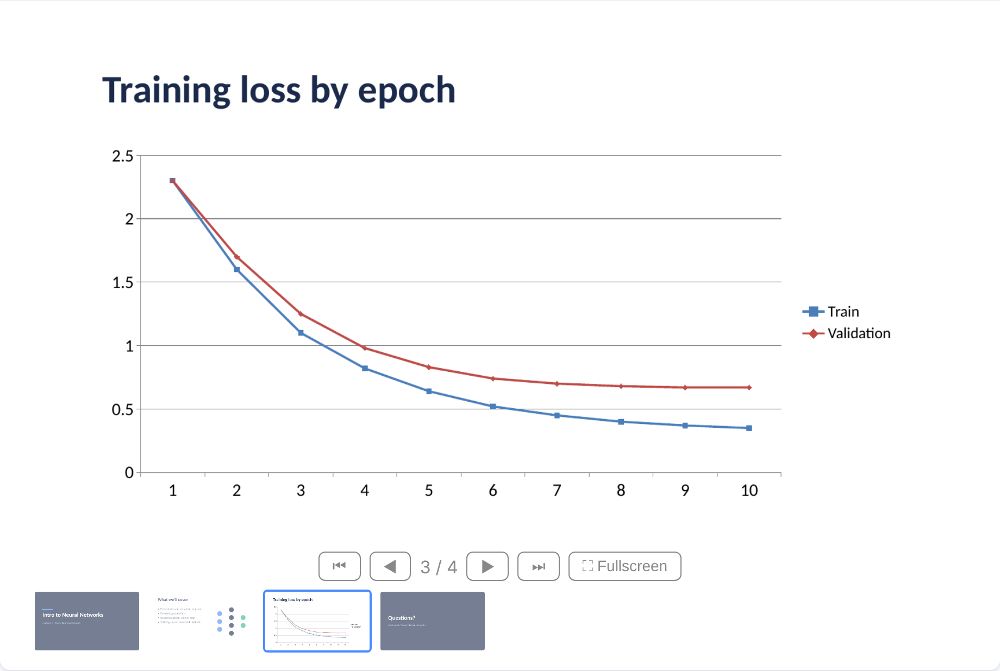
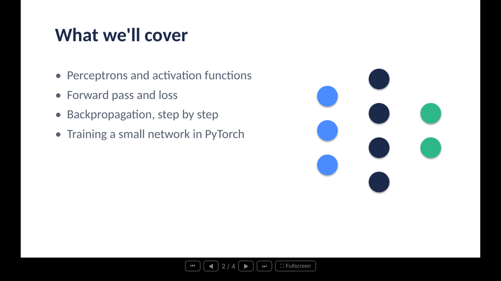

# colab-slides

[](https://pypi.org/project/colab-slides/)
[](https://pypi.org/project/colab-slides/)
[](https://github.com/AhmadM-DL/colab-slides/blob/main/LICENSE)
[](https://colab.research.google.com/github/AhmadM-DL/colab-slides/blob/main/demo.ipynb)

Show PowerPoint or Google Slides decks inside a Google Colab or Jupyter notebook by pasting a link.


## Install (in Colab)

```python
!pip install -q colab-slides
```

## Use

```python
%load_ext colab_slides

%slides https://docs.google.com/presentation/d/<ID>/edit      # Google Slides
%slides https://drive.google.com/file/d/<ID>/view             # .pptx in Drive
%slides https://example.com/talk.pptx                          # direct link
%slides /content/drive/MyDrive/deck.pptx                       # mounted Drive / uploaded file
%slides https://example.com/talk.pptx --local --width 1000     # force in-notebook rendering
```

Or from Python:

```python
import colab_slides
colab_slides.show(url, mode="auto")   # "auto" | "embed" | "local"
```

## Modes

| Mode | How it works | Good for |
|------|--------------|----------|
| `embed` | Uses the Google Slides embed viewer or Microsoft Office Online in an iframe. Nothing to install. Keeps animations and transitions. | Public links |
| `local` | Downloads the file, converts it with LibreOffice → PDF → PNG inside the Colab VM, and shows a built-in slideshow. | Private files (mounted Drive), uploaded files, links the online viewers can't open |
| `auto` (default) | Uses `embed` when the link can be embedded, otherwise `local` | — |

The first `local` render installs LibreOffice in the Colab VM (about 1–2 minutes, once per runtime).

**Slideshow controls (local mode):** ← → / Space / PageUp/PageDown, Home/End, `f` for fullscreen, click the left or right part of a slide, or click a thumbnail.

### Screenshots

| Slideshow with thumbnails | Fullscreen (press `f`) |
|---|---|
|  |  |

## Supported links

- Google Slides (`/edit` links and "Publish to web" links)
- Google Drive file links (shared as "Anyone with the link")
- Dropbox share links
- OneDrive / SharePoint share links (embed only)
- Any direct URL to a `.pptx`, `.ppt`, `.odp` or `.pdf`
- Local paths

## Limits

- `local` mode shows static images: animations, transitions, embedded video and audio aren't kept.
- Fonts that aren't installed in the VM are replaced with similar ones, so layouts can shift slightly.
- Office Online only opens files that are publicly downloadable over HTTPS.

## License

MIT
